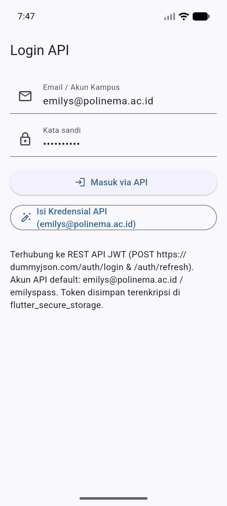
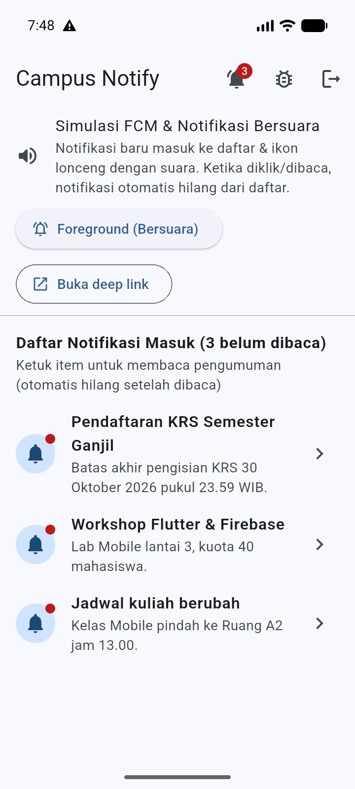
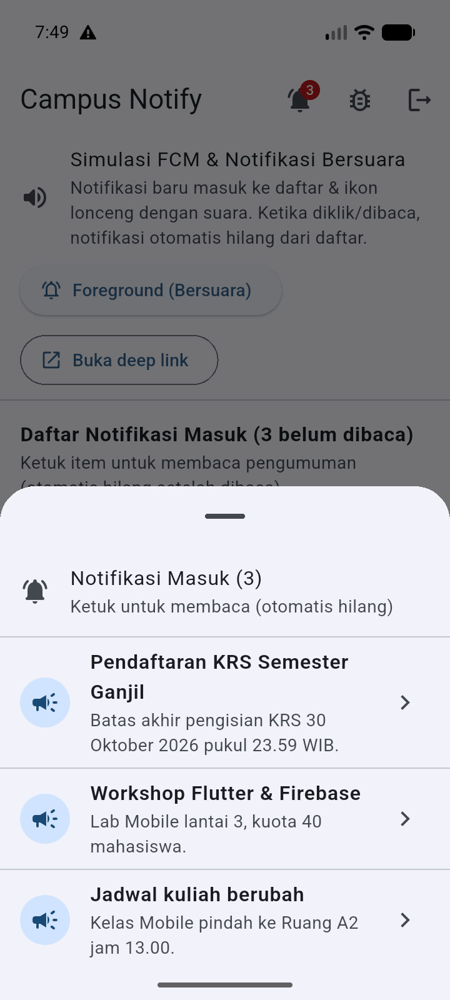
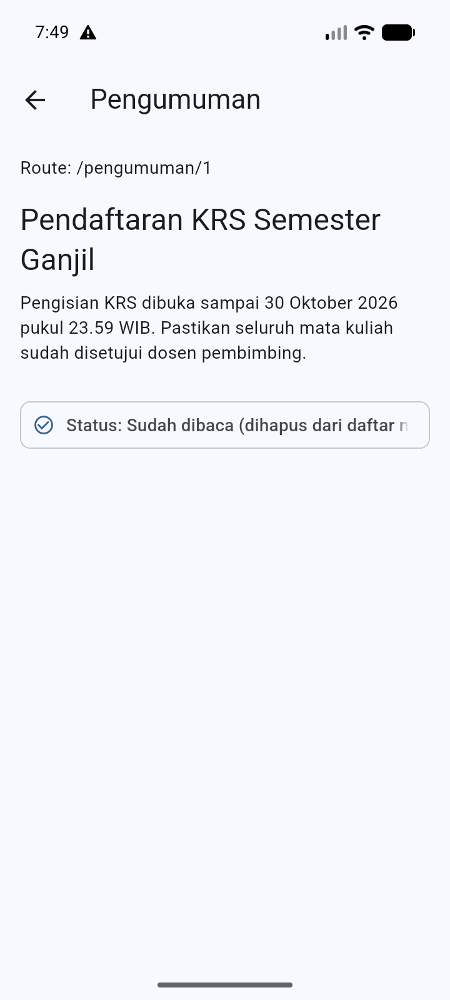
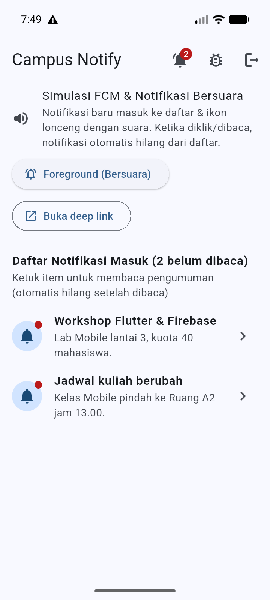
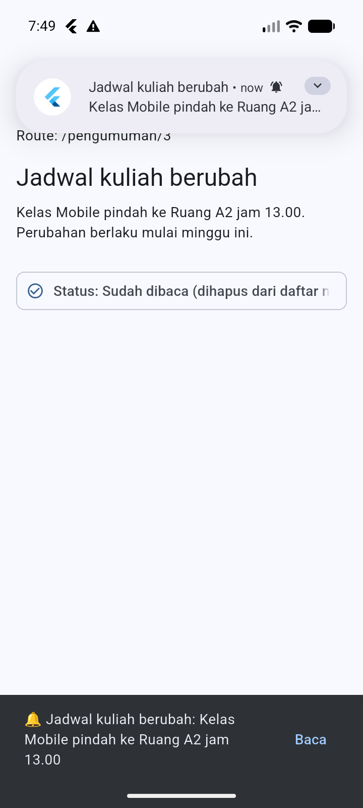

# Campus Notify — Week 9

Implementasi codelab **06 | Authentication, Security & FCM** sebagai satu
project Flutter mandiri, ditempatkan pada folder minggu 9.

- Project: [`campus_notify/`](campus_notify)
- README lengkap: [`campus_notify/README.md`](campus_notify/README.md)
- Dokumentasi AI challenge & hasil pengujian: [`campus_notify/docs/`](campus_notify/docs)
- Screenshot bukti: [`campus_notify/screenshots/`](campus_notify/screenshots) & [`screenshots/`](screenshots)

## Ringkasan Fitur

| Aspek | Implementasi |
| --- | --- |
| **1. Login dari API** | Terhubung ke REST API JWT (`POST https://dummyjson.com/auth/login` & `/auth/refresh`, akun: `emilys@polinema.ac.id` / `emilyspass`) + guard route GoRouter |
| **2. Notif Masuk List & Hilang Saat Dibaca** | `NotificationInboxNotifier` menambahkan setiap notifikasi baru ke daftar belum dibaca di Home, dan **otomatis menghapusnya ketika diklik/dibaca** |
| **3. Notif Masuk di Icon** | Ikon lonceng di `AppBar` menampilkan `Badge` jumlah notifikasi belum dibaca secara *real-time* beserta *bottom sheet* daftar notifikasi masuk |
| **4. Bonus: Notif Bersuara** | Channel `pengumuman_bersuara` (`Importance.max`, `playSound: true`) + native Android `RingtoneManager` / `ToneGenerator` di `MainActivity.kt` |
| **Token & Keamanan** | `flutter_secure_storage` untuk access, refresh, dan FCM token; token dipotong 12 karakter di halaman Debug |
| **Dio Refresh 401** | Interceptor `Authorization: Bearer`, refresh sekali saat 401, logout paksa bila refresh mati |
| **FCM & Deep Link** | Permission, `getToken`, `onTokenRefresh` (`POST /devices`), topik `pengumuman-kampus`, klik membuka `/pengumuman/:id` di 3 app state |
| **Kualitas** | `flutter analyze` bersih (**No issues found**), **18 unit test lulus** |

## Cuplikan Screenshot

| Login API | Home (3 Notif Masuk & Badge Icon `3`) | Bottom Sheet Ikon Lonceng |
| :---: | :---: | :---: |
|  |  |  |

| Detail Dibaca (`/pengumuman/1`) | Setelah Dibaca (Hilang dari List & Badge `2`) | Foreground Bersuara & Deep Link |
| :---: | :---: | :---: |
|  |  |  |

## Menjalankan

```bash
cd campus_notify
flutter pub get
flutter analyze
flutter test
flutter run
```

## Refleksi

1. **Mengapa refresh token tidak boleh disimpan di `SharedPreferences`? Apa risikonya bila bocor?**
   `SharedPreferences` menyimpan data dalam XML *plaintext* tanpa enkripsi. Bila perangkat di-*root* atau terjadi celah *backup*, *refresh token* yang berumur panjang dapat dicuri untuk mencetak *access token* baru secara terus-menerus (*session hijacking*). Karena itu token wajib disimpan di `flutter_secure_storage` (Keystore/Keychain).
2. **Apa yang rusak bila `onTokenRefresh` diabaikan selama satu semester perkuliahan?**
   Token FCM dapat berubah saat reinstall, *clear data*, ganti perangkat, atau rotasi keamanan. Tanpa `onTokenRefresh` yang mengirim token baru ke `POST /devices`, backend akan menyimpan token basi sehingga notifikasi personal mahasiswa gagal terkirim selama sisa semester.
3. **Kapan memakai topik dan kapan memakai token perangkat? Beri contoh pesan kampus untuk masing-masing.**
   - **Topik (`pengumuman-kampus`):** untuk *broadcast* publik ke banyak mahasiswa sekaligus (contoh: pengumuman libur akademik, perubahan ruang kuliah umum, info seminar).
   - **Token perangkat:** untuk pesan personal/rahasia milik satu mahasiswa tertentu (contoh: nilai KHS keluar, tagihan UKT pribadi, persetujuan KRS dosen wali).
4. **Bagian mana dari draf AI yang Anda tolak atau perbaiki, dan mengapa?**
   Background handler di dalam kelas diubah menjadi fungsi *top-level* dengan `@pragma('vm:entry-point')`, penyimpanan `SharedPreferences` diganti `flutter_secure_storage`, log token penuh dihapus (dipotong 12 karakter di halaman Debug), `onTokenRefresh` dihubungkan ke `POST /devices`, banner *foreground* ditampilkan manual via `flutter_local_notifications`, dan rute payload divalidasi dengan `routeFromMessage` (detail di [`campus_notify/docs/ai-challenge.md`](campus_notify/docs/ai-challenge.md)).
