# Campus Notification App

Project praktikum **Minggu 6: Authentication, Security & FCM**, dikerjakan
sebagai satu project Flutter mandiri pada folder minggu 9.

## Tujuan

- Menjelaskan alur autentikasi REST API JWT dan perbedaan access token, refresh
  token, serta ID token.
- Menyimpan token hanya di secure storage dan menerapkan refresh otomatis pada
  Dio ketika menerima 401.
- Mengintegrasikan Firebase Cloud Messaging: permission, registration token,
  `onTokenRefresh`, topik, dan tiga handler app state.
- Menampilkan notifikasi masuk ke dalam **daftar notifikasi belum dibaca** dan
  **badge angka pada ikon lonceng** di `AppBar`, serta **menghapus otomatis
  notifikasi dari daftar ketika sudah dibaca/diklik**.
- Memutar **suara notifikasi** (bonus) baik di foreground maupun background.
- Menangani klik notifikasi menjadi deep link `/pengumuman/:id` memakai GoRouter.
- Menerapkan prinsip keamanan dasar: tidak ada secret di kode, token tidak
  dicetak penuh, refresh token tidak lewat query URL.

## Fitur utama

1. **Login dari API + guard route** — autentikasi terhubung ke REST API JWT
   (`POST https://dummyjson.com/auth/login` & `/auth/refresh`, akun uji:
   `emilys@polinema.ac.id` / `emilyspass`); belum login selalu diarahkan ke
   `/login`.
2. **Secure token store** — access, refresh, dan FCM token hanya melewati
   `TokenStore` berbasis `flutter_secure_storage`.
3. **Dio dengan refresh otomatis** — 401 memicu tukar refresh sekali lalu
   mengulang request satu kali; bila refresh ikut mati, sesi dibersihkan.
4. **PushService** — `requestPermission`, `getToken`, `onTokenRefresh` yang
   dikirim ke `POST /devices`, `onMessage`, `onMessageOpenedApp`,
   `getInitialMessage`, serta subscribe/unsubscribe topik.
5. **Background handler top-level** — `firebaseMessagingBackgroundHandler`
   dengan `@pragma('vm:entry-point')`, tanpa BuildContext/Riverpod.
6. **Daftar Notifikasi Masuk (Ketika Dibaca Hilang)** — setiap notifikasi baru
   masuk ke `NotificationInboxNotifier` pada halaman Home; begitu diklik/dibaca,
   item otomatis dihapus dari daftar.
7. **Badge Notifikasi di Ikon Lonceng** — ikon lonceng di `AppBar` menampilkan
   jumlah notifikasi belum dibaca secara *real-time* dan membuka *bottom sheet*
   daftar notifikasi masuk saat diketuk.
8. **Notifikasi Bersuara (Bonus)** — `flutter_local_notifications` dengan
   channel `pengumuman_bersuara` (`Importance.max`, `playSound: true`) dilengkapi
   native Android `RingtoneManager` / `ToneGenerator` di `MainActivity.kt`.
9. **Deep link konsisten** — semua rute berasal dari `lib/routes.dart`.
10. **Mode demo** — bila `google-services.json` belum ada, aplikasi tetap bisa
    dijalankan dan alur notifikasi dapat disimulasikan.

## Stack teknologi

| Kebutuhan | Paket |
| --- | --- |
| State management | `flutter_riverpod` 3.4.3 |
| Navigasi & deep link | `go_router` 18.1.1 |
| HTTP client | `dio` 5.11.1 |
| Penyimpanan token | `flutter_secure_storage` 11.2.0 |
| Firebase | `firebase_core` 5.1.0, `firebase_messaging` 17.0.1 |
| Notifikasi lokal & suara | `flutter_local_notifications` 22.3.3 + Android `RingtoneManager` |

## Struktur folder

```text
campus_notify/
├── lib/
│   ├── main.dart                          # bootstrap Firebase + container Riverpod
│   ├── app.dart                           # MaterialApp.router, inisialisasi push & inbox
│   ├── router.dart                        # GoRouter + redirect guard
│   ├── routes.dart                        # konstanta rute (dipakai FCM & UI)
│   ├── data/
│   │   ├── auth_repository.dart           # login & refresh JWT dari REST API
│   │   ├── token_store.dart               # secure storage + abstraksi untuk test
│   │   ├── api_client.dart                # Dio + interceptor refresh sekali
│   │   ├── api_errors.dart                # DioException -> pesan ramah
│   │   └── device_repository.dart         # POST /devices untuk token FCM
│   ├── messaging/
│   │   ├── push_service.dart              # FCM + background handler top-level
│   │   ├── demo_push_service.dart         # simulasi saat Firebase belum siap
│   │   ├── notification_presenter.dart    # local notification + suara & badge
│   │   ├── push_message.dart
│   │   └── route_parser.dart              # fungsi murni routeFromMessage
│   ├── providers/
│   │   ├── app_providers.dart
│   │   ├── auth_provider.dart
│   │   └── notification_inbox_provider.dart # state list notif masuk & badge icon
│   └── pages/                             # login, home, announcement, debug
├── test/
│   ├── auth_push_test.dart                # parsing route, token store, refresher, inbox
│   └── api_client_test.dart               # login API, refresh 401, POST /devices via HttpServer
├── docs/
│   ├── ai-challenge.md                    # prompt, output awal AI, perbaikan manual
│   └── pengujian-app-state.md             # matriks uji tiga app state + bukti
├── screenshots/
└── README.md
```

## Cara menjalankan

```bash
cd campus_notify
flutter pub get
flutter analyze
flutter test
flutter run
```

Mode demo aktif otomatis jika Firebase gagal diinisialisasi. Untuk FCM
sungguhan:

1. Buat project Firebase dan daftarkan aplikasi Android dengan
   `applicationId = id.polinema.campus_notify`.
2. Simpan `google-services.json` di `android/app/`.
3. Untuk iOS, tambahkan `GoogleService-Info.plist`, aktifkan capability Push
   Notifications, dan unggah APNs key di Firebase Console.
4. Jalankan ulang aplikasi, lalu kirim pesan uji dari Firebase Console dengan
   payload gabungan:

```json
{
  "message": {
    "topic": "pengumuman-kampus",
    "notification": {
      "title": "Jadwal kuliah berubah",
      "body": "Kelas Mobile pindah ke Ruang A2 jam 13.00"
    },
    "data": {
      "route": "/pengumuman/3",
      "id": "3"
    }
  }
}
```

## Hasil pengujian tiga app state

| State | Yang diharapkan | Hasil | Bukti |
| --- | --- | --- | --- |
| Foreground | Banner lokal bersuara muncul, badge bertambah, klik masuk `/pengumuman/3` | Sesuai | `screenshots/05-foreground-banner.png` |
| Background | Banner sistem muncul, klik masuk rute yang benar & hapus dari list | Sesuai | `screenshots/06-background-banner.png`, `screenshots/06b-background-deep-link.png` |
| Terminated | Proses mati, klik banner membuka aplikasi di rute tujuan | Sesuai (PID kosong sebelum klik) | `screenshots/07-terminated-notification-tray.png`, `screenshots/08-terminated-deep-link.png` |

Detail langkah dan catatan ada di [`docs/pengujian-app-state.md`](docs/pengujian-app-state.md).

## Dokumentasi Screenshot

| Tampilan | Deskripsi | Screenshot |
| --- | --- | --- |
| **1. Login API** | Form login terhubung ke REST API JWT (`POST https://dummyjson.com/auth/login`) dengan akun `emilys@polinema.ac.id` | 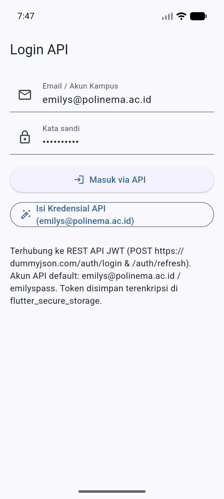 |
| **2. Proses Login API** | Pengiriman kredensial ke endpoint REST API sebelum menyimpan JWT ke `flutter_secure_storage` | 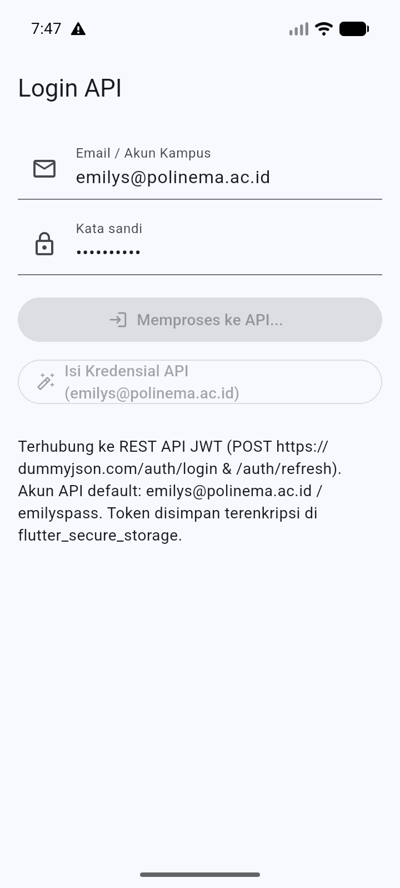 |
| **3. Home: Notif Masuk di List & Badge Icon (`3`)** | Halaman utama menampilkan **badge angka `3` pada ikon lonceng** di `AppBar` serta **Daftar Notifikasi Masuk (3 belum dibaca)** | 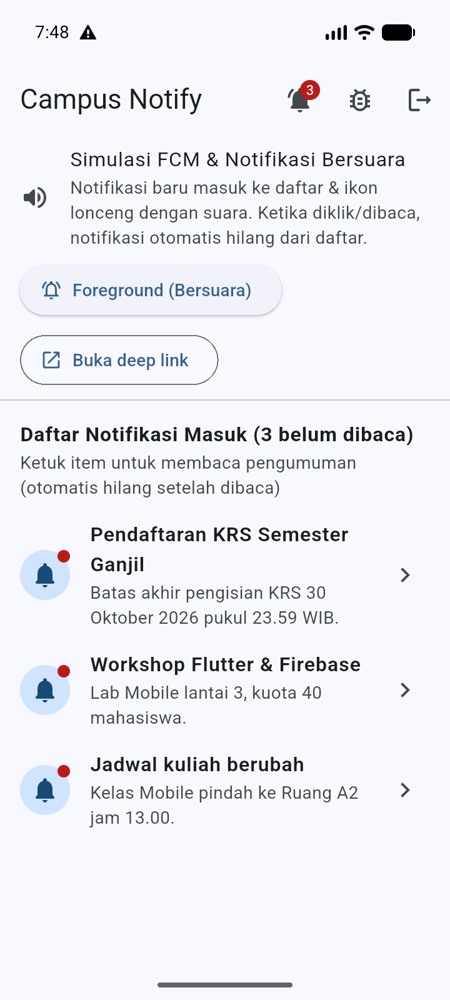 |
| **4. Daftar Notif pada Ikon Lonceng** | Saat ikon lonceng di `AppBar` diketuk, tampil *bottom sheet* daftar notifikasi masuk yang belum dibaca | 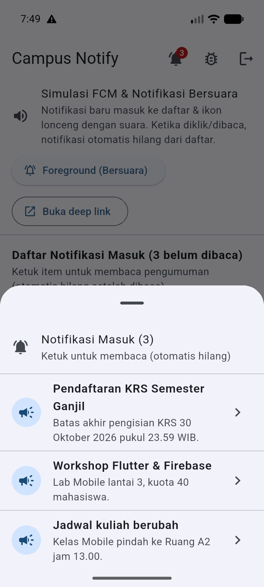 |
| **5. Membaca Detail Pengumuman** | Halaman `/pengumuman/1` terbuka dan menandai notifikasi sebagai **Sudah dibaca (dihapus dari daftar notifikasi masuk)** | 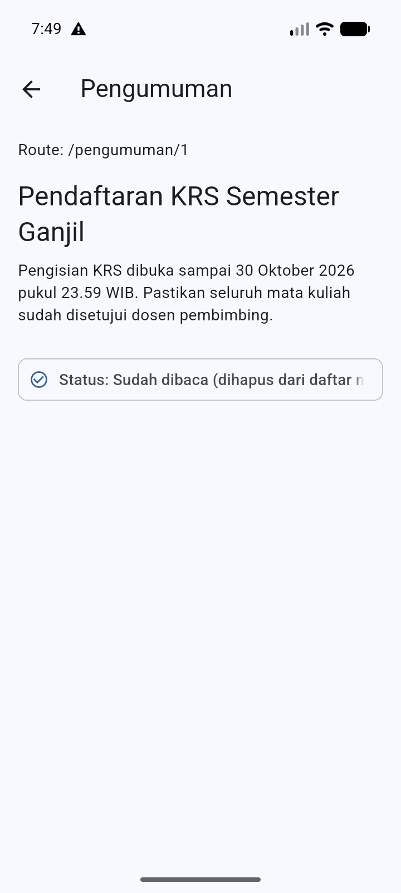 |
| **6. Setelah Dibaca: Notif Hilang dari List & Badge Berkurang (`2`)** | Kembali ke Home: pengumuman #1 **hilang dari daftar** dan angka badge pada ikon lonceng berkurang menjadi **`2`** | 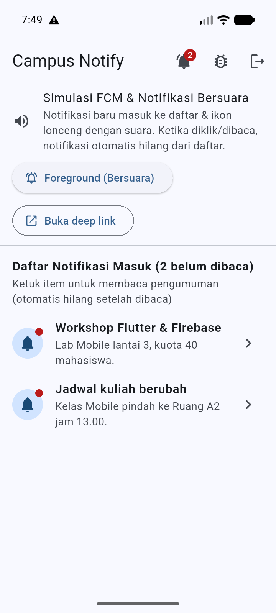 |
| **7. Halaman Debug FCM & Uji Suara** | Menampilkan token FCM terpotong (12 karakter), topik `pengumuman-kampus`, badge ikon, serta tombol **Uji Suara** | 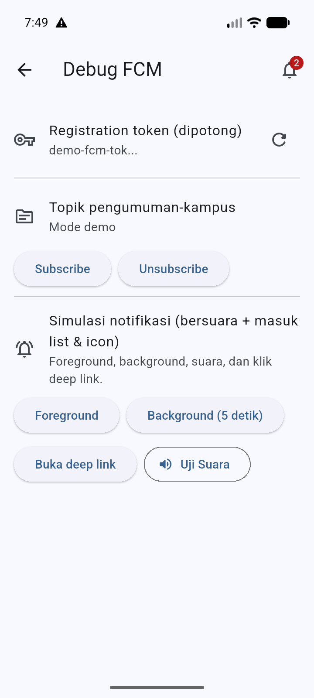 |
| **8. Notifikasi Foreground Bersuara** | Saat notifikasi foreground tiba: suara berbunyi, snackbar `Baca` muncul, dan badge ikon bertambah kembali menjadi **`3`** | 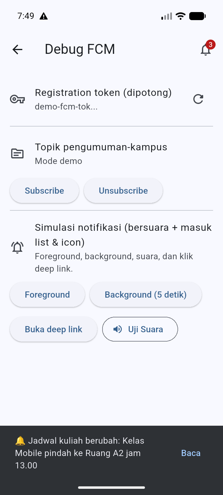 |
| **9. Banner Sistem & Deep Link `/pengumuman/3`** | Klik banner sistem membuka `/pengumuman/3` dan menghapus item dari daftar belum dibaca | 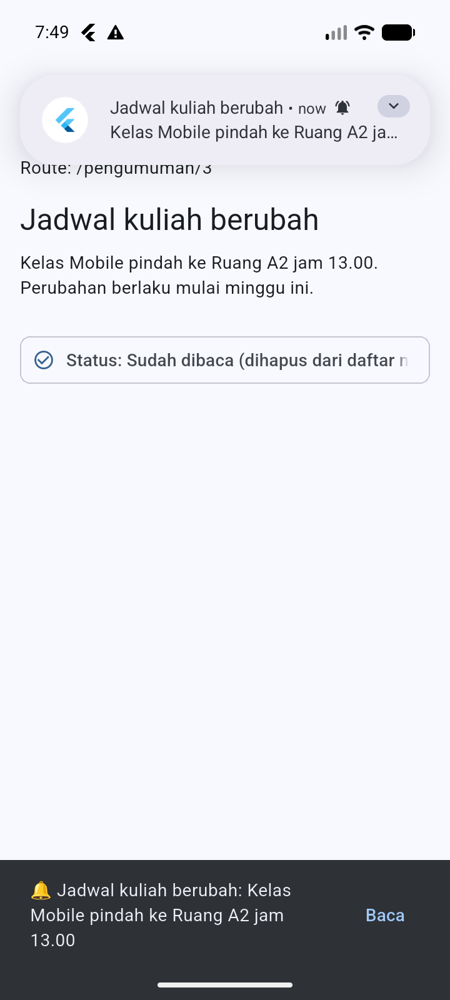 |
| **10. State Background & Terminated** | Bukti notifikasi pada notification shade saat aplikasi di-minimize / dimatikan penuh | 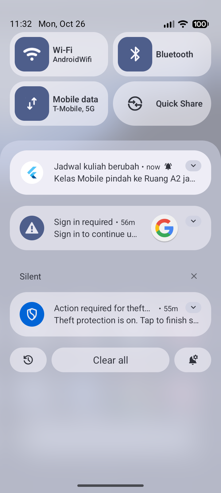 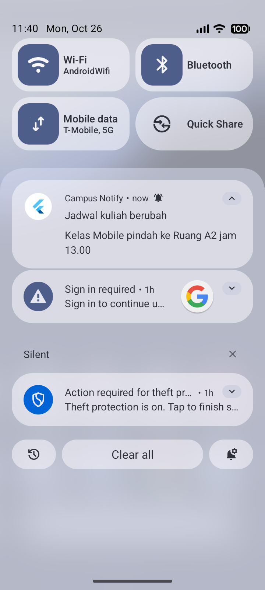 |

## Keamanan

- Token hanya disimpan lewat `flutter_secure_storage`; tidak ada pemakaian
  SharedPreferences untuk token.
- Tidak ada token/secret yang di-hardcode di Dart maupun Gradle.
- Halaman Debug hanya menampilkan 12 karakter pertama token.
- Refresh token dikirim lewat body POST, tidak pernah sebagai query string.
- `routeFromMessage` menolak rute di luar `/pengumuman/:id` sehingga payload
  tidak bisa membuka halaman sembarangan.

## Hasil

- `flutter analyze` → **No issues found**
- `flutter test` → **18 test lulus**
- `flutter build apk --debug` → berhasil
- Bukti visual tersedia di folder `screenshots/`

## Refleksi

### 1. Mengapa refresh token tidak boleh disimpan di `SharedPreferences`? Apa risikonya bila bocor?
`SharedPreferences` menyimpan data dalam bentuk file XML biasa (*plaintext*) di penyimpanan internal aplikasi tanpa enkripsi perangkat keras. Pada perangkat yang di-*root*, melalui celah *backup* tidak terenkripsi, atau eksploitasi *path traversal*, file XML ini dapat dibaca langsung. Karena *refresh token* berumur panjang (misalnya 7–30 hari) dan berfungsi untuk mencetak *access token* baru tanpa kredensial pengguna, kebocoran *refresh token* memungkinkan penyerang mengambil alih sesi pengguna (*session hijacking*) secara terus-menerus meskipun *access token* sudah kedaluwarsa. Oleh karena itu, *refresh token* wajib disimpan di `flutter_secure_storage` yang memanfaatkan Android Keystore / iOS Keychain.

### 2. Apa yang rusak bila `onTokenRefresh` diabaikan selama satu semester perkuliahan?
*Registration token* FCM tidak bersifat permanen; token akan berubah ketika mahasiswa menginstal ulang aplikasi, menghapus data aplikasi (*clear data*), memulihkan aplikasi di perangkat baru, atau saat Firebase melakukan rotasi keamanan berkala. Jika `onTokenRefresh` diabaikan dan token baru tidak dikirim ke backend (`POST /devices`), maka database kampus akan terus menyimpan token lama yang sudah mati (*stale token*). Akibatnya, pengiriman notifikasi personal (seperti perubahan jadwal mendadak, nilai ujian, atau tagihan UKT) ke mahasiswa tersebut akan gagal (`UNREGISTERED` / `NotRegistered`) selama sisa semester tanpa diketahui pengguna.

### 3. Kapan memakai topik dan kapan memakai token perangkat? Beri contoh pesan kampus untuk masing-masing.
- **Topik (*Topic Messaging*):** Dipakai untuk pesan *broadcast* publik/kelompok yang isinya sama untuk banyak penerima dan tidak memuat data rahasia pribadi. Pengiriman cukup ke satu nama topik (misalnya `pengumuman-kampus`, `angkatan-2024`, atau `kelas-ti-3a`) tanpa perlu melakukan *looping* ribuan token di server.
  - *Contoh pesan kampus:* Pengumuman libur akademik, perubahan ruangan kuliah umum, informasi seminar kampus, atau jadwal KRS.
- **Token Perangkat (*Device Registration Token*):** Dipakai untuk pesan personal/spesifik pengguna yang bersifat rahasia atau hanya relevan bagi satu akun/perangkat yang terdaftar di tabel pengguna backend.
  - *Contoh pesan kampus:* Notifikasi nilai KHS keluar, pengingat tagihan UKT mahasiswa yang bersangkutan, persetujuan bimbingan dosen wali, atau peringatan login dari perangkat baru.

### 4. Bagian mana dari draf AI yang Anda tolak atau perbaiki, dan mengapa?
Beberapa bagian draf awal AI yang ditolak dan diperbaiki secara manual (dokumentasi lengkap di [`docs/ai-challenge.md`](docs/ai-challenge.md)):
1. **Background handler sebagai method kelas** → Ditolak dan diubah menjadi fungsi *top-level* `firebaseMessagingBackgroundHandler` dengan anotasi `@pragma('vm:entry-point')`, karena background isolate membutuhkan *entry point* statis/top-level agar tidak dihapus *tree-shaking* saat build rilis.
2. **Penyimpanan token di `SharedPreferences` & pencetakan token penuh ke log** → Ditolak dan diganti dengan `TokenStore` berbasis `flutter_secure_storage`, serta pemotongan tampilan token hanya 12 karakter pertama di halaman Debug agar token tidak bocor melalui log maupun screenshot laporan.
3. **`onTokenRefresh` yang hanya melakukan `debugPrint`** → Diperbaiki agar memanggil `DeviceRepository.registerToken` (`POST /devices`) sehingga backend selalu memiliki token terbaru.
4. **Mengandalkan banner sistem saat *foreground*** → Diperbaiki dengan menambahkan `flutter_local_notifications` (`NotificationPresenter.show`) pada listener `FirebaseMessaging.onMessage`, karena FCM tidak menampilkan banner otomatis ketika aplikasi sedang terbuka.
5. **Navigasi rute mentah tanpa validasi** → Diperbaiki dengan memusatkan konstanta rute di `lib/routes.dart` dan memvalidasi payload melalui fungsi murni `routeFromMessage` agar payload eksternal tidak dapat mengarahkan aplikasi ke rute sembarangan.
